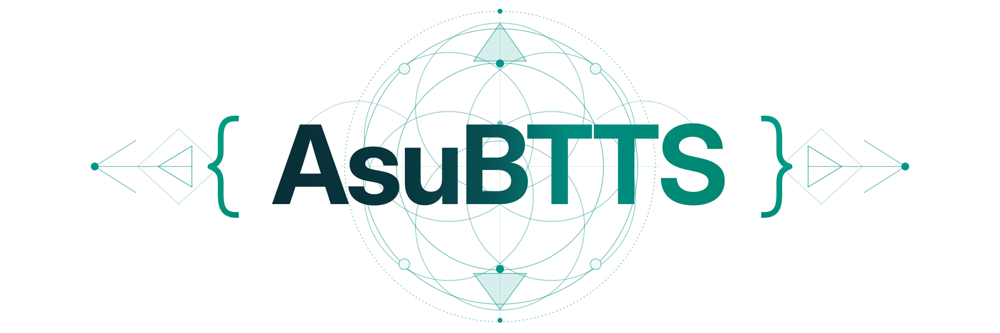

  

## About me 👋

Hi, I'm **Asu** (AsuBTTS).

**BTTS** stands for *"Back to the Silence (Soul)."*

My Japanese name is **ShirahaKanade（白羽 奏）**.

I'm a software engineering undergraduate.

I'm interested in **C++**, **Game Development**, **Computer Graphics**, and I'm currently learning **Unreal Engine 5**.

I like building little worlds, experimenting with ideas, and making things that feel meaningful to me.

 

## Tech Stack ⚙️

**Core**

**Web Development**

## Projects 🛠️

- **[Daily Classical](http://154.8.222.12/)** — A web community dedicated to discovering and exploring classical music.
- **Principled NPR** — A stylized rendering toolkit for Unreal Engine 5.
- **Clocks and Clouds** — (In development...) An experimental musical game inspired by György Ligeti.

## Like 🧡

- 🎼 **Classical Music** — Mahler, Scriabin, Messiaen, Ligeti, and many more.
- 🎮 **Game Development** — Creating interactive worlds and exploring new possibilities.
- 💻 **Programming** — C++, graphics, and creative tools.
- 📖 **Art & Literature** — Reading, writing, cinema, and everything in between.

## Contact Me 🌿

GitHub Statistical Information 📊

